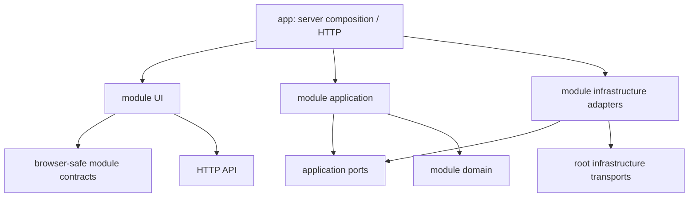

# Architecture

Status: Phase 1 preparation, based on `main` at `383cf5956b7e8a0705586936c78b7efd29ec6102`. Existing production code is unchanged. This guide is the target for incremental work, not a claim that current code already conforms.

PR 16 completes [Shipment DTO physical ownership](shipments-dto-ownership.md): all eight original type declarations now live in browser-safe `modules/shipments/contracts.ts`. The legacy types leaf explicitly forwards the public enum/types; the unchanged status leaf remains the single runtime enum owner. Public runtime exports and all caller behavior are preserved. Current ownership supersedes temporary DTO-owner claims in historical PR summaries below. Legacy leaf/barrel retirement and the overall Shipments milestone remain incomplete.

PR 15 completes only [physical ShipmentStatus ownership](shipments-enum-ownership.md): the original single enum now lives in pure `modules/shipments/status.ts`. Public contracts and the legacy types/barrel forward the same object; eight DTO declarations stay in the legacy leaf. Current ownership supersedes the temporary enum-owner statements in the historical PR summaries below. Orders picker/detail seams remain unchanged, with no reverse module dependency. DTO/barrel retirement and the full Shipments milestone remain incomplete.

PR 2 established [Orders browser contracts](orders-contracts.md) at `src/modules/orders/contracts.ts`. PR 3 now consolidates all 15 Orders UI/client/style files under `src/modules/orders/ui/`; route wrappers and server use cases remain in place. See the [UI migration and consumer audit](orders-ui-migration.md). The Phase 1 statement above records the preparation baseline.

PR 4 implements the [initial Orders use-case seam](orders-use-case-seam.md): `listOrders` and simple `createOrder` now use consumer-owned ports and feature Sheets adapters, composed through `modules/orders/server.ts`. Legacy exports remain; detail/images/drafts and other services stay in place. Contracts and UI are unchanged.

PR 5 establishes [Shipment browser contracts and characterization](shipments-contracts.md), the first slice of the Shipments milestone. Five existing frontend/client files use named public contracts; the single enum remains in a restricted pure legacy leaf pending Orders/Shipments decoupling. The [UI/client relocation](shipments-ui-relocation.md) is now complete: six presentation/style files plus the byte-identical browser HTTP client live under `modules/shipments/ui`. The [Orders-owned picker seam](orders-shipment-picker.md) now removes both Orders browser imports through client-side app composition, eliminating the reverse browser module edge and allowing PR 8 to finish the client move with no forwarding shim. The full Shipments milestone remains incomplete; server projections, use cases, adapters and enum ownership remain deferred.

PR 9 implements only the [Shipment creation seam](shipments-create-seam.md): a consumer-owned writer port, existing Sheets row adapter and named server composition replace the legacy creation body behind an unchanged API/barrel. Validation/clock/ID/append behavior is preserved. Drive, Orders server projection and enum ownership remain unmigrated after the read/link/status extractions below.

PR 10 implements the [Shipment list/detail read seam](shipments-read-seam.md): a business snapshot reader port, one four-worksheet Sheets adapter and named server composition preserve the old read exports. Application owns filtering, associations, unchanged cost formulas and reverse/detail selection; storage mapping stays in the adapter. Only this read slice is complete, not the Shipments milestone.

PR 11 implements the [Shipment order-linking seam](shipments-link-seam.md): a consumer-owned deferred snapshot/write port, existing three-sheet adapter and named server composition preserve original lookup/error precedence, one error class, idempotency and A:G append behavior. Only that linking slice is complete; Drive/projection/enum debt and the overall milestone remain open.

PR 12 implements the [Shipment status-update seam](shipments-status-seam.md): a consumer-owned opaque target keeps row mechanics/raw cells in the Sheets adapter and transition/validation/clock decisions in application. Original M1-before-read/B:M behavior and PATCH/Drive ownership are retained. This completes only status updates, not the full milestone.

PR 13 implements the [Shipment shipping-bill workflow seam](shipments-drive-seam.md): conditional upload/status coordination and cleanup are application-owned; a lazy Drive adapter reuses the existing provider. PATCH keeps validation/configuration/HTTP translation, with original getter/error/order and cleanup semantics. Orders server projection, enum ownership and legacy cleanup remain deferred; full milestone is incomplete.

PR 14 implements [Orders detail Shipment projection decoupling](orders-detail-shipment-projection.md): Orders-owned business ports and a Shipment-owned adapter preserve five-read ordering and deferred mapping. App GET injects the projection; a narrow legacy-only composition keeps old callers compatible. No Orders-module reverse Shipment import is introduced. Enum physical ownership and broader legacy cleanup remain deferred.

The application is a Next.js App Router shop operations workspace using React, Ant Design, Google Sheets, Google Drive, LINE, and Loyverse. Feature ownership should make changes local and make persistence replaceable without changing business behavior. Future SaaS and Supabase work is intentionally deferred: this phase introduces no provider, schema, auth, tenant context, subscription, or runtime abstraction.

```text
src/
  app/                        Next.js entrypoints and composition
  modules/
    orders/                   Purchase orders, bills, product images, quantities
    shipments/                Shipments, linked orders, delivery status
    inventory/                Movements, stock counts, stock adjustments
    sales/                    Receipt sync, daily sales, profit/cost reports
    expenses/                 Expense ledger, categories, shop master data
    hr/                       Employees, compensation, attendance, advances, payroll
    line-workflows/           LINE journeys, commands, sessions, rich-menu content
    workspace/                Home/navigation and workspace-level presentation
  infrastructure/
    persistence/              Shared Sheets transport; future storage transport
    external/                 LINE and Loyverse protocol clients
    files/                    Drive and future file storage transport
  shared/
    ui/                       Proven generic reusable UI
    lib/                      Proven generic utilities
    types/                    Small genuinely cross-cutting contracts
  config/                     Existing environment-backed server configuration
```

Within a module, create `domain`, `application`, `infrastructure`, or `ui` only when needed. No empty target directories are created in Phase 1. Route URLs retain their current names even when the owner is different: `/employees` belongs to `hr`, `/stock-counts` and `/movements` to `inventory`, and `/loyverse/daily-sales` to `sales`.



Application ports are TypeScript interfaces owned by the use case that consumes them. A future repository migration can replace the adapter at composition points; it must not leak database rows, worksheet columns, tenant assumptions, or SDK types into business rules. Do not build those interfaces for every service now. First characterize one use case and extract the smallest interface it needs.

Read next:

- [Current structure and dependency audit](audit.md)
- [Exact folder ownership](folder-rules.md)
- [Import rules and public contracts](dependency-rules.md)
- [Current file → proposed destination map](migration-map.md)
- [Incremental PR plan](refactoring-plan.md)
- [Regression baseline and verification](verification.md)
- [ESLint enforcement rollout](eslint-boundaries.md)

Repository-wide working rules live in [AGENTS.md](../../AGENTS.md).


## PR 19 — Google shared infrastructure

PR 19 completes only [shared Google transport/auth ownership](google-shared-infrastructure.md): root Sheets/auth/JWT and Drive implementations retain exact named legacy forwards and constructor identity. Generic row/base types have a root owner; feature worksheet registry/classes/headers and all consumers remain in place. No provider or business behavior changes.
